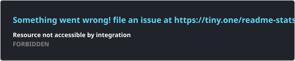

# 👨‍💻 Erik Victorino

**`Desenvolvedor Back-end | Node.js, Express | MySQL & MongoDB | APIs REST | Estagiário em Dev & IA`**

Sou desenvolvedor back-end e estagiário em **Desenvolvimento e IA na MX3**, em Londrina-PR. No dia a dia crio automações e integrações com **n8n**, conectando APIs, bancos de dados e serviços externos, e participo da implantação de software para clientes.

Curso **Análise e Desenvolvimento de Sistemas** na Unicesumar e estudo principalmente Node.js, arquitetura MVC, autenticação e bancos de dados relacionais e NoSQL.

- 🔭 Hoje: automações e integrações com n8n e IA na MX3
- 🌱 Estudando: APIs REST, autenticação com JWT, boas práticas de back-end
- 💼 Aberto a oportunidades em **back-end** (presencial, híbrido ou remoto)
- 📫 Fale comigo pelo [LinkedIn](https://www.linkedin.com/in/erik-victorino-b04684260/)

### 🚀 Projetos em destaque

| Projeto | O que tem de interessante | Stack |
|---|---|---|
| [💈 Barbearia (The Barber)](https://github.com/erikvictorino/barbearia-node.js) · [deploy](https://the-barber-hair.vercel.app) | Agendamento com escolha de barbeiro e horário, login com JWT e BCrypt, painel admin por tipo de usuário, redefinição de senha por e-mail, rate limit e upload no Cloudinary | Node.js, Express, Sequelize, MySQL, Vercel |
| [🛒 E-commerce](https://github.com/erikvictorino/e-commerce-mongoDB) | Catálogo de produtos com CRUD completo e modelagem de dados com Mongoose | Node.js, Express, MongoDB |
| [🍔 Hamburgueria](https://github.com/erikvictorino/Hamburgueria-node.js) | Refatoração de arquivo único para MVC e migração de SQL puro para ORM, com upload de imagens | Node.js, Express, Sequelize, MySQL |
| [📚 CRUD de Livros](https://github.com/erikvictorino/-Projeto-CRUD-de-Livros-Node.js-MySQL) | CRUD com queries SQL e pool de conexões | Node.js, Express, MySQL |

### 🤖 Linguagens e Tecnologias

### 📊 Estatísticas

